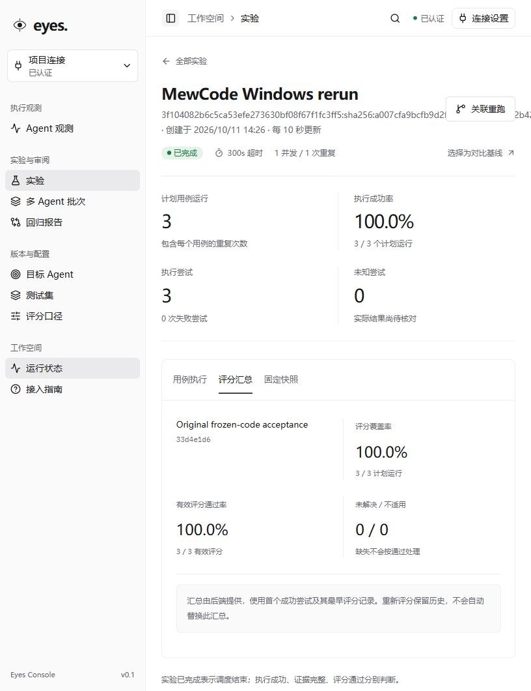

# MewCode Windows 重新验证

日期：2026-10-11（Asia/Shanghai）。结论：**本次真实统一 HTTP 基础闭环通过，3/3 执行成功、3/3 独立评分通过，12/12 原有功能检查通过。** 本轮首次部署失败另外保留，未覆盖为成功。

## 环境与固定版本

- Windows 11，工作目录 `D:\projects\eyes`，PowerShell；宿主机 CPython 3.14.4、Node v22.14.0、Docker Engine 29.8.2。
- Eyes：`1f25f9ff9307c1303fb7410262c4f98b4acd5f86`，源码摘要 `4a85bc849ca03e1b0d2a3ccce24017b03fbaeb6b01be3af684b3c7d589920834`。API、Agent、Runner、Scheduler 的 71 个安装源码文件均与当前仓库逐项相同，无额外 Python 文件。
- MewCode：`3f104082b6c5ca53efe273630bf08f67f1fc3ff5`，源码摘要 `a007cfa9bcfb9d2f1051a154c6f64d2b42542fc83061d45ba046787d0b94e35d`。没有修改 MewCode 核心源码。
- Linux CPython 3.14.7，镜像 `sha256:420dba75f4b41b95976e91e0d590cfc9d1fb3397a8a64b39c1c21ed167ceca2a`。使用已有缓存依赖并同步当前 Eyes/接入源码；实际依赖保存于私有目录，不宣称等同于完整 uv.lock。
- PostgreSQL 15.17，本次独立 initdb 数据目录 `private/postgres`，端口 55440；空数据库实际依次应用 0001～0005，head=`0005_reconciliation`。
- API：`http://127.0.0.1:18060`，就绪检查 200；Agent：`http://127.0.0.1:19050`；Web：`http://127.0.0.1:18082`。Runner 与 Agent 共享容器网络，通过 loopback HTTP 交互；没有 Python Agent 绑定。
- 沿用现有 DeepSeek `deepseek-flash` 参数：thinking=false、context_window=128000、max_output_tokens=8192、最多 12 轮；并发 1、执行截止 300 秒、评分截止 40 秒、证据等待 15 秒。
- 数据集和评分器直接使用 `integrations/deta/coding-smoke.jsonl` 与 `integrations/deta/scorer.py`，没有新增或修改用例、评分口径或仓库测试。

## 本次新实验

实验：`f796e3cd-e59e-4361-b188-dea7edd5280e`。项目：`c7deefdb-a06d-459d-8b87-0bdd7833d623`。目标：`51850337-ed17-4355-b95c-7ef6257969b2`。数据集：`132752e6-4b40-48bd-9733-c4577757f0da`。评分器：`33d4e1d6-5c25-442d-bc44-7beb5d598525`。

| 原任务 | 执行 | 独立功能评分 | 耗时（秒） | Eyes / Agent 事件 | 产物 |
| --- | --- | --- | --- | --- | --- |
| fix-mean | succeeded | pass，4/4 | 10.113 | 24 / 20 | 3 |
| integer-cli | succeeded | pass，4/4 | 8.312 | 20 / 16 | 2 |
| stable-unique | succeeded | pass，4/4 | 8.341 | 16 / 12 | 3 |

耗时取 Eyes 的 execution_intent_at 到 finished_at，包括轮询和上传。成功实验失败尝试、unknown、未解决评分均为 0。每个任务只运行一次，不构成稳定性或容量结论。

## 证据与协议核对

- 三个任务均 stopped_confirmed=true、cleanup=succeeded、evidence=sealed，报告 dropped_events=0。
- 60 条 Eyes 事件中的 48 条外部事件，其身份、顺序和内容与 Agent 端全部一致。8 份产物在两端下载后逐项核对字节、大小和 SHA-256，全部一致。
- 独立评分实际执行下载后的冻结代码，每项 4 个检查；每个 ScoreRun 绑定正确 Manifest，证据引用全部属于授权视图，评分 trace 与执行 trace 不同。
- 发现、按键查询、状态、结果及同键重放返回 200；同键更改 task_id 和同 attempt 更换键均返回 409。
- Agent 端缺失/错误凭据及误用 Eyes Runner 凭据均返回 401。Eyes read 读取成功，read 发布目标和 Runner 读取管理结果均返回 403；当前目标 Runner 下载产物为 200。来自另一数据库的旧 Runner 令牌返回 401，未将其算作同库跨目标授权验收。
- MewCode 声明不支持取消和输入资源，实际端点返回 422/unsupported_capability。
- 任务完成并停止 Runner 后，实际重启 Agent 服务；三个运行的完整快照、原 run_id 均保持一致。此项仅验证已完成运行的持久化，不是活动任务崩溃恢复验收。
- 已采集证据中没有匹配本次 read/manage/Runner/Agent 和模型密钥的字面值；扫描不是对任意秘密的完整识别保证。

## 前端与静态检查

本机浏览器用本次 read 令牌连接独立项目，实际打开新实验，核对已完成、执行成功 3/3、失败和未知均为 0、评分覆盖率 3/3、有效评分通过率 3/3。评分页面截图见下方。

实际通过：`ruff check src migrations integrations`、`ruff format --check src migrations integrations`（93 个文件）、前端 `npm run lint`、`npm run format:check`、`npm run build`（TypeScript 与 Vite）。未新建或运行仓库测试套件。

## 首次失败与调整

首次实验 `c8285e4d-655e-47a9-b79f-164be0eae5c8` 的第一项真实 Agent 已产生代码及轨迹，但旧缓存镜像的 `/app/integrations/mewcode/bridge.py` 遮蔽当前源码，缺少必需的 schema_version，返回 backend_exception/unknown。评分器也存在同类旧安装路径。该轮不是成功验收：最终保留 1 个 unknown、取消其余 2 个排队用例，状态 completed_with_unresolved；没有人工确认未知结果或释放其额度。

停止首次 Runner/Agent 并保留容器、协议存储及 Runner 目录后，同步当前 integrations 与 Eyes 安装代码，Agent 工作目录改为 `/runtime`。在独立新项目和新 Agent/Runner 状态目录重新创建上述成功实验；旧实验、代码产物和失败记录未覆盖。完整本轮实际业务运行数为首轮 1 项加成功轮 3 项。

环境准备时 pg_ctl 已启动数据库，但子进程继承输出句柄令采集脚本等待；停止本轮采集进程后使用已运行数据库继续。最初状态采集沿用了 GBK 写入，已改为 UTF-8 后重新从 API 采集。后台启动 Web 的命令被自动审批策略拒绝，随后通过受工具管理的前台进程启动成功。

## 文件与当前运行状态

公开：[summary.json](summary.json)、本报告、[scores.png](scores.png)。私有：`private/` 下保存凭据、实际依赖、迁移/部署日志、API 原始响应、事件、产物、冻结评分输入、源文件校验和首次失败材料；该目录被 Git 忽略，Windows ACL 仅授予当前用户，Docker 构建也排除整个 MewCode 记录目录。

本轮 Runner 与 Scheduler 已停止；API、Agent、独立 PostgreSQL 和 Web 保留运行供查询。刷新 Web 后需重新连接项目；本机可从 `private/read-credential.json` 读取 read 令牌，禁止将凭据提交或写入公开报告。

本次范围是统一 HTTP 真实执行、独立评分、证据、基础认证、同键重放及已完成服务重启。活动 Runner 崩溃、unknown 自动核对故障矩阵、双 Agent 并发、真实版本改善/退化、完整 Compose 和容量均未重跑，不宣称 M0～M4 全部验收。
