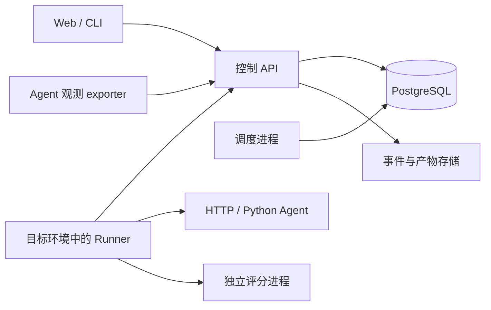

# Eyes

[](https://github.com/pretextQ/eyes/actions/workflows/ci.yml)


**自托管的 AI Agent 评测与执行观测平台。**

Eyes 把测试集、Agent 执行、评分依据和过程证据关联起来，帮助开发者判断任务是否完成、理解失败原因，以及比较 Agent 修改后的改善与退化。

你可以导入自己的任务和评分规则，通过 Runner 调用外部 Agent，查看逐用例结果、工具事件和产物，再生成固定的回归报告。也可以只接收 Agent 的过程事件，用于日常执行观测。

当前版本为 **0.1.0，处于真实接入与可靠性验收阶段**。已有 MewCode Python/HTTP 与 trae HTTP 的真实执行、评分和证据记录，双 Agent 并发及 trae 被动观测通过已覆盖场景；完整发布验收仍在推进。

## 主要能力

| 能力          | 当前实现                                                       |
| ------------- | -------------------------------------------------------------- |
| 自定义评测    | JSONL 测试集、版本化用例、规则评分和可信 Python 评分器         |
| Agent 接入    | 统一协议 HTTP 客户端、通用 HTTP 与本地 Python 适配器，按能力和凭据匹配 Runner  |
| 执行调度      | 独立执行与评分额度、租约和心跳、取消请求；未知状态保留额度，统一协议支持原操作只读核对 |
| 多 Agent 批次 | 一次创建多个独立实验，成员分别配置任务集、评分器与并发；MewCode/trae 双目标实际并发已验证 |
| 执行证据      | SDK 事件、trace/span 关联、产物上传与摘要校验、证据完整性标识  |
| 独立评分      | 评分绑定固定证据清单，支持错误重试和重新评分，保留历史         |
| 回归对比      | 逐用例可比性检查、改善/退化统计、固定报告及 CLI 质量门槛       |
| Web 控制台    | 实验、批次、用例审阅、评分历史、回归报告、目录与运行状态       |
| 被动观测      | 独立会话/任务事件入口、执行流程图；trae 真实接入、离线补传和按需重启已验收 |
| 运维          | 数据库迁移、存储审计、证据保留、文件回收及数据库/证据备份恢复  |

模型评分可以通过可信 Python 评分器接入。内置评分器不会自动判断任意业务任务，也不会把 Agent 自述当作任务已完成的证明。

## 两条使用路径

### 主动评测

接入 Agent → 导入测试集 → 发布评分器 → 创建实验或批次 → Runner 执行 → 查看评分与证据 → 对比迭代。

每次实验冻结目标、测试集、评分器和执行配置。执行状态、评分结论与证据完整性分别记录：执行成功不等于任务质量通过，`sealed` 只代表声明采集范围已封存。

重新评分产生新的 ScoreRun，不覆盖旧记录。回归报告默认选择首个成功执行的最早评分；Web 也支持显式选择历史评分，生成绑定所选记录的新报告。

### 被动观测

在 Agent 中照常发起任务 → exporter 上报实际事件 → Eyes 展示会话、模型和工具调用。

此路径不需要测试集、评分器或 Runner，不创建评测实验。当前 Windows 宿主机配合本机 Docker Linux 已完成 trae 的真实被动观测、API 暂停后的持久补传、权限、Web 展示及按需停止/重启验收；其他 exporter、缓冲满和磁盘故障等场景仍待验证。MewCode 的现有记录覆盖主动评测 Python/HTTP 接入。详见[被动观测说明](docs/observation.md)与[trae 实际验收](docs/observation-trae-acceptance-20261012.md)。

## 系统结构



控制后端管理版本、实验、调度状态、评分和证据；Runner 主动通过认证 API 领取、续租并上报，不直接连接数据库。目标 Agent 负责自己的推理和工具执行，适配器负责转换接入接口。

普通控制契约现在要求显式 `schema_version: "1.0"`，包括 JSONL 行及已提供的嵌套契约；统一 Agent 的 `protocol_version` 保持独立。旧客户端、请求文件、outbox 和历史快照的升级边界见[版本迁移说明](docs/contract-version-migration.md)。

主要技术：Python 3.14+、FastAPI、Pydantic、SQLAlchemy、PostgreSQL、OpenTelemetry，以及 React、TypeScript、Vite 和 shadcn/Base UI。

## 当前验证进度

状态更新至 **2026-10-13（Asia/Shanghai）**。实现、静态检查和真实运行验收分别记录；下表的通过均限于对应记录的环境与场景，M0～M4 尚未全部验收通过。

| 范围 | 已有真实证据 | 剩余边界 |
| --- | --- | --- |
| Agent 基础闭环 | MewCode Python/统一 HTTP 与独立 trae HTTP 接入；最新两目标各 3/3 执行、3/3 独立评分通过，修正 trae 另完成 3/3；九项正常闭环共 15 份产物摘要匹配 | 复杂仓库任务、独立宿主机复现及完整能力矩阵 |
| 双 Agent 并发与恢复 | 实际执行边界重叠约 6.38 秒；目标并发各 1、项目执行额度 2；成员准备失败隔离、批次取消及原键核对通过。原故障两任务已无重跑补齐 61 原生事件/4 产物、新清单和清理事实，显式独立评分 2/2 pass；补传整体退出、过期租约续传和重复核对已复验 | 两个目标均未支持取消/资源正向能力；完整故障矩阵及远端未知清理分支仍保留，历史评分不自动替换 |
| 被动观测 | trae 直接任务不经过实验或 Runner；3 个真实观测任务、100 事件，51 条离线事件持久补传一致；40 个权限请求、Web 展示和重启核对通过 | 强杀 exporter、缓冲满、磁盘故障、其他 exporter 及观测自动保留清理 |
| 回归比较 | 同一 MewCode 的两个真实版本各 3/3 pass、正反向无变化；历史评分选择、证据引用、分母及 CLI 0/1/2/3 已验证 | 真实改善/退化仍缺合适的可比版本材料，当前阻塞 |
| 部署与备份恢复 | 干净控制 Compose、迁移 0005、真实 HTTP 接入及 131 个权限请求通过；独立恢复 47 份 ready 产物、341 事件、86 清单、25 评分、17 报告和 2 个 unknown 占额工作 | 其他权限、生命周期及恢复分支；被动观测材料的备份恢复未在该轮覆盖 |
| 按需运行与容量 | 已就绪组件启动、真实评分/读取、正常停止和重启后数据一致；有限读取并发及评分吞吐测量已有记录 | Runner 启动早期立即停止仍有限制；Agent 执行容量、大报告、慢盘和长期趋势未验证，24h 仅为未来可选验证 |
| 已修复问题 | Runner 坏恢复载荷隔离、评分基础设施错误分类、BUG-001～004、nginx 安全头与比较缓存已有定向验收；Eyes 观测来源文案已修正 | 指定场景通过不代表完整故障矩阵；新 Agent 的预算预留与模型停止未确认修正在其独立仓库 |

MewCode 和 trae 是用于验证平台接入能力的两个真实 Agent。既有三任务是基础功能冒烟，不代表完整编码能力、任意代码安全隔离或生产容量。

最新范围见[独立复核](docs/acceptance-followup-20261012.md)、[双 Agent 验收](docs/dual-agent-acceptance-20261012.md)、[被动观测验收](docs/observation-trae-acceptance-20261012.md)与[开发计划](docs/PLAN.md)。

## 启动控制平台

### Docker Compose

需要 Docker Engine 与 Compose，或运行 Linux 容器的 Docker Desktop。在项目根目录执行：

```powershell
Copy-Item deploy/.env.example deploy/.env
```

将 `deploy/.env` 中的 `POSTGRES_PASSWORD` 改为自行生成的随机十六进制密码。上述命令在 Windows PowerShell 中执行。配置完成后：

```sh
docker compose --env-file deploy/.env -f deploy/compose.yaml up --build -d
docker compose --env-file deploy/.env -f deploy/compose.yaml exec api eyes-admin bootstrap --name default
```

`bootstrap` 在首次初始化时创建项目，输出项目 ID 和一次性管理令牌；不要把它当作每次重启的步骤。保存令牌，在 Web 的“连接设置”中连接项目。

| 入口       | 默认地址                           |
| ---------- | ---------------------------------- |
| Web 控制台 | http://127.0.0.1:8080              |
| 控制 API   | http://127.0.0.1:8000              |
| API 文档   | http://127.0.0.1:8000/docs         |
| 就绪检查   | http://127.0.0.1:8000/health/ready |

Compose 包含 PostgreSQL、迁移、API、Scheduler 和 Web，**不包含可直接执行任意 Agent 的 Runner**。仅启动控制平台不会自动运行任务。数据库和证据使用独立数据卷。

控制镜像以 `eyes`（UID/GID 10001）运行；新建证据卷的根目录为该用户所有、权限 `0700`，产物文件为 `0600`。升级镜像不会修改已有卷权限。部署者应核对实际卷的所有权和权限，以服务用户执行 `eyes-ops audit`，再检查 readiness 和授权下载；已有卷若需交接，按[恢复说明](docs/platform.md#恢复)定向处理，不要放宽为全用户可读写。独立干净 Compose 的实际检查见[部署与权限验收](docs/clean-deployment-permissions-20261011.md)。

此前 Windows/MewCode 实测使用独立 Windows PostgreSQL、Linux API/Runner 和原生 Scheduler/Web，启动方式见 [MewCode 接入说明](integrations/mewcode/README.md)。2026-10-11 已在独立项目/新卷按锁文件无缓存构建并启动完整控制 Compose、迁移 0005、首次 bootstrap 和真实 HTTP 三任务闭环，详见[部署与权限验收](docs/clean-deployment-permissions-20261011.md)。后续观测与双 Agent 使用各自独立环境，不能将各轮子集通过视为全部 M4 或容量验收。

### 按需停止与再次启动

日常可以按需启动使用，无需为了当前验收连续运行 24 小时。停止前先核对活动及 unknown 工作，按实际目标能力停止或等待任务；正常停止独立 Runner 和 Agent 后，再停止控制平台。在项目根目录的 PowerShell 中：

```powershell
docker compose --env-file deploy/.env -f deploy/compose.yaml stop
# 再次使用，保留原数据库与证据卷
docker compose --env-file deploy/.env -f deploy/compose.yaml up -d
```

再次启动后等待 `/health/ready` 就绪，再启动对应 Agent 和 Runner、连接 Web；使用原项目，无需重复 bootstrap。Runner 必须复用原持久状态目录，保留待确认上传和恢复记录。unknown 不能因为停止或重启就释放额度或重新执行；统一 `agent_http` 由匹配 Runner 按原操作只读核对，其他接入按[恢复说明](docs/unknown-recovery.md)处理。不要用 `down -v` 作为日常停止命令，它会删除命名数据卷。

已就绪组件的按需使用周期及限制见[按需验收](docs/ondemand-acceptance-20261012.md)；这不保证任意启动时刻或任意目标的活动任务都能确认停止。

### 源码开发

自 2026-10-11 起，项目只在当前 Windows 宿主机 `D:\projects\eyes` 开发，默认使用 PowerShell。开发约定见 [AGENT.md](AGENT.md#windows-开发环境)。验证证据以当前 Windows 宿主机及本机 Linux 容器的实际记录为准。

API 与 Runner 依赖 POSIX 能力，在本机 Docker Desktop 的 Linux 容器中运行。目录 `fsync`、进程组及资源限制尚不支持完整原生 Windows 路径。已有 Windows 启动方式见 [MewCode 接入说明](integrations/mewcode/README.md#本机重启与再次评测)。

准备 Python 3.14+、uv、Node.js 22.12+、可用的 PostgreSQL 和运行 Linux 容器的 Docker Desktop。在项目根目录的 PowerShell 中：

```powershell
uv sync --frozen
Copy-Item .env.example .env
```

编辑 `.env` 的 `EYES_DATABASE_URL`，连接专用 PostgreSQL 数据库。迁移和 bootstrap 可在 Windows PowerShell 执行：

```powershell
uv run alembic upgrade head
uv run eyes-admin bootstrap --name default
```

API 在本机 Linux 容器内启动，配置数据库和证据卷；具体构建、网络及启动步骤见上述 MewCode 说明或 [Compose 部署](#docker-compose)。在另一 PowerShell 终端运行 `uv run eyes-scheduler`，API 与 Scheduler 使用相同数据库及调度配置。启动前端：

```powershell
Set-Location frontend
npm ci
npm run dev
```

开发前端默认地址为 http://127.0.0.1:5173，API 为 http://127.0.0.1:8000。API 使用其他地址时，在 `frontend/.env.local` 配置 `EYES_API_PROXY_TARGET`；示例见 [frontend/.env.example](frontend/.env.example)。Web 的项目令牌只保存在页面内存中，刷新后需重新连接。

## 仓库 CI

[GitHub Actions 工作流](.github/workflows/ci.yml) 在推送、Pull Request 和手动触发时并行执行三组检查，使用 `uv.lock` 和 `frontend/package-lock.json` 安装固定依赖。Python 锁文件使用官方 PyPI 下载地址；Git 属性将前端文本文件统一为 LF 换行，避免 Windows 检出后的格式检查差异。

- 后端（Python 3.14）：`ruff check src migrations`、`ruff format --check src migrations`。
- 数据库迁移（PostgreSQL 18 服务容器）：在干净数据库上执行 `alembic upgrade head`，验证 `downgrade base` 后可重放，`alembic check` 确认模型与迁移无漂移，再启动 `eyes-server` 冒烟验证 `bootstrap` 和 `/health/ready`。
- 前端（Node.js 24，与前端 Docker 构建一致）：`npm run lint`、`npm run format:check`、`npm run build`；构建包含 TypeScript 类型检查。

在 Windows PowerShell 中运行同样的静态检查：

```powershell
uv sync --frozen
uv run --no-sync ruff check src migrations
uv run --no-sync ruff format --check src migrations
cd frontend
npm ci
npm run lint
npm run format:check
npm run build
```

服务就绪检查中的 `eyes-server` 必须在本机 Linux 容器内运行。迁移检查需要一个空的 PostgreSQL 数据库，通过 `EYES_DATABASE_URL` 指定后依次运行上述 alembic 命令和 `eyes-server`；本机 Docker 可用时可参照 `.github/workflows/ci.yml` 的服务容器配置。

这些检查覆盖代码规范、格式、类型、前端构建，以及干净库上的迁移可逆性与最小服务就绪验证，不运行外部 Agent 或真实评测，也不代表调度恢复或部署验收通过。产品的 `eyes gate` 回归质量门槛与仓库 CI 分开使用。

## 接入 Agent 与 Runner

Runner 在当前 Windows 的 Linux 容器内安装并运行，配置路径与目标解释器均使用容器内路径。可以先在项目根目录的 PowerShell 中复制并修改配置：

```powershell
Copy-Item deploy/runner.example.toml runner.toml
```

将配置放入容器后，在容器内执行：

```sh
uv run eyes-runner --config runner.toml plugins
uv run eyes-runner --config runner.toml status
```

先发布目标版本和评分器，再在控制端签发限制到该项目、目标及执行/评分工作类型的 Runner 令牌。将其通过 `EYES_RUNNER_TOKEN` 环境变量提供，随后运行：

```sh
uv run eyes-runner --config runner.toml run
```

- 统一 HTTP 接入（`agent_http`）：实现协议 v1 的能力、幂等运行、查询及结果接口，先发现并冻结能力，再发布目标；配置允许的 origin 和独立 Agent 凭据。
- 通用 HTTP 接入（`http`）：配置允许的 origin，并按现有任务接口实现请求、结果及实际支持的取消/查询行为；重启后的自动核对能力与统一协议不同。
- Python 接入：配置可信的执行、准备、清理入口及解释器；评分器可以使用独立解释器。
- 多个 Runner 使用不同凭据与状态目录。容器内的 `localhost` 指向该容器，应按实际网络配置服务地址。
- 会话隔离、环境隔离、取消和幂等必须如实声明，Eyes 据此匹配任务和限制并发。

完整步骤见 [Agent 接入文档](docs/agent-integration.md)。MewCode 桥接、运行配置与采集工具位于 [integrations/mewcode](integrations/mewcode/README.md)。

语言无关的[统一 Agent 协议 v1](docs/agent-protocol.md)已有 `agent_http` Runner 客户端与持久化参考 HTTP 服务；旧 HTTP/Python 保持兼容。发现、发布及责任边界见[运行时文档](docs/agent-http-runtime.md)。MewCode 与 trae 已完成独立 HTTP 闭环及双目标定向验收，见[最新记录](docs/dual-agent-acceptance-20261012.md)。trae 的模型/工具循环及 exporter 位于[独立 Agent 仓库](https://github.com/pretextQ/trae-agent)，不在 Eyes 核心源码中。

## 回归与运维

开发者 CLI 使用 `EYES_TOKEN` 提供项目令牌，默认连接 `http://127.0.0.1:8000`；可用 `--url` 指定 API。

```sh
uv run eyes --help
uv run eyes compare --file comparison.json --key release-comparison
uv run eyes gate REPORT_UUID
uv run eyes-ops audit
uv run eyes-ops maintain
```

`comparison.json` 使用真实实验和评分器 UUID，请求格式见[平台说明](docs/platform.md)。`eyes gate` 的退出码分别为：0 通过、1 不通过、2 无法判定、3 配置或服务错误。

`eyes-ops` 在控制端使用其数据库与证据卷配置。`maintain` 默认预览，`--apply` 才执行清理。备份恢复、升级和保留策略须按[运维说明](docs/platform.md)操作。

## 数据与执行边界

- 项目管理/读取令牌、Runner 令牌、Agent HTTP 凭据、观测来源写入令牌和模型 API key 分开使用。来源令牌只写对应观测来源，项目 read/manage 负责项目范围读取/管理。目标快照保存密钥引用，不保存明文凭据；本机 `.env`、`data/` 和前端本地配置不提交 Git。
- Python 插件及 shell 按可信代码管理。独立目录、独立进程或本轮容器部署不能自动视为安全沙箱。
- 未确认停止的外部任务保持未知；本地进程退出或租约失效不证明远端任务已经停止。
- 观测范围取决于实际接口与埋点。缺失、截断、丢弃和过期证据应明确显示，不能推断隐藏执行过程。
- 重新评分、迟到证据和报告生成保留历史；显式选择新评分不会改变原实验汇总。
- Outbox 孤立文件保存在私有 `outbox-orphaned` 目录供排查，需人工管理保留；被动观测记录尚无自动保留清理策略。

## 文档与源码导航

| 主题               | 入口                                                                               |
| ------------------ | ---------------------------------------------------------------------------------- |
| 架构与阶段验收     | [architecture.md](docs/architecture.md)                                            |
| 后端、认证与 API   | [backend.md](docs/backend.md)                                                      |
| Agent/Runner 接入  | [agent-integration.md](docs/agent-integration.md)                                  |
| 回归、证据与运维   | [platform.md](docs/platform.md)                                                    |
| 多 Agent 批次      | [multi-agent-batches.md](docs/multi-agent-batches.md)                              |
| 被动观测           | [observation.md](docs/observation.md)                                              |
| Web 与前端质量     | [frontend.md](docs/frontend.md)   |
| MewCode 接入与实测 | [接入说明](integrations/mewcode/README.md)、[验证记录](docs/mewcode-validation.md) |
| 双 Agent 与最新独立验收 | [双 Agent 记录](docs/dual-agent-acceptance-20261012.md)、[独立复核](docs/acceptance-followup-20261012.md) |
| trae 被动观测与按需启停 | [观测验收](docs/observation-trae-acceptance-20261012.md)、[按需验收](docs/ondemand-acceptance-20261012.md) |
| 故障处理修复进度   | [bug-fix-plan.md](docs/bug-fix-plan.md)                                            |
| 当前开发与验收计划 | [PLAN.md](docs/PLAN.md)                                                            |
| 开发约定           | [AGENT.md](AGENT.md)                                                               |

```text
src/eyes/contracts/   公共数据契约
src/eyes/server/      控制 API、调度、证据、评分、回归与运维
src/eyes/runner/      宿主机执行、进程控制及持久化发送队列
src/eyes/adapters/    HTTP/Python 适配器
src/eyes/sdk/         事件和链路采集
src/eyes/scorers/     内置规则评分
src/eyes/cli/         开发者 CLI
frontend/            Web 控制台
migrations/          PostgreSQL 迁移
deploy/              通用部署示例
integrations/        真实 Agent 接入案例
docs/                设计、使用和验证记录
```

## 下一步

unknown 核对成功后的原执行证据、清理事实及显式独立评分已完成[定向恢复修复与复验](docs/evidence-recovery-20261013.md)。同一 Agent 的真实改善/退化仍等待合适的可比版本材料；按实际需要推进支持取消/资源的目标、观测记录生命周期、剩余故障/权限及容量边界。已通过范围不重复开发；24 小时及多日运行仅为未来可选目标。任务优先级和完整里程碑条件以[开发计划](docs/PLAN.md)为准。
